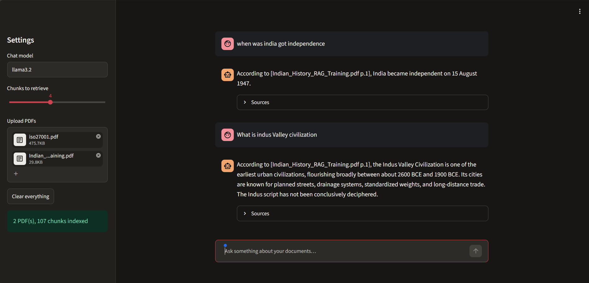
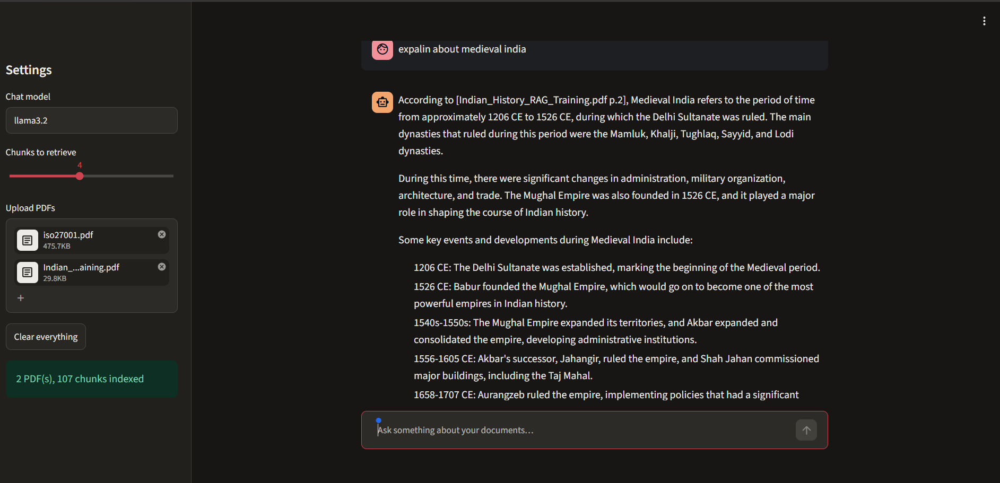
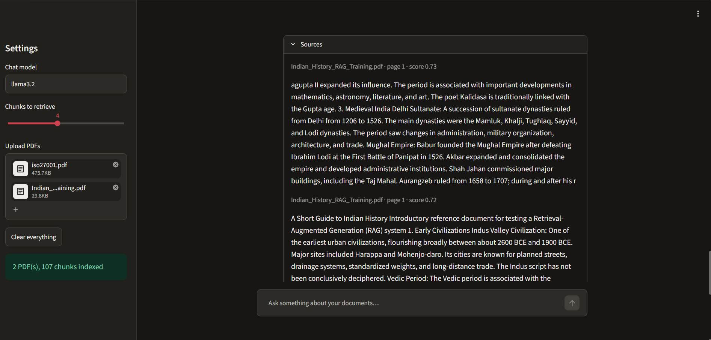

# PDF Chat: Local RAG App
## Demo



Ask questions about your PDFs and get answers with page citations. Runs fully offline with Ollama, so no API keys and no cost.

## How it works
1. **Extract:** pypdf reads the text of each page.
2. **Chunk:** each page is split into overlapping 800-character chunks.
3. **Embed:** `nomic-embed-text` (via Ollama) turns each chunk into a vector.
4. **Retrieve:** your question is embedded and the most similar chunks are found using cosine similarity (NumPy).
5. **Generate:** the top chunks go into the prompt and `llama3.2` answers using only that context, citing file and page.

## Tech stack
Python, Streamlit, Ollama (llama3.2, nomic-embed-text), NumPy, pypdf

## Setup
1. Install Ollama from https://ollama.com and make sure it is running.
2. Pull the models:
   ```
   ollama pull llama3.2
   ollama pull nomic-embed-text
   ```
3. Install and run:
   ```
   python -m venv env
   env\Scripts\activate
   pip install -r requirements.txt
   streamlit run app.py
   ```
4. Upload a PDF in the sidebar and start asking questions.

## Notes
- Scanned PDFs without selectable text are not supported (no OCR).
- On a slow PC, use a smaller model: `ollama pull llama3.2:1b` and type `llama3.2:1b` in the sidebar.

## Ideas to extend
Persistent vector store (ChromaDB), OCR for scanned PDFs, hybrid search (BM25 + vectors), evaluation set to measure answer quality.
